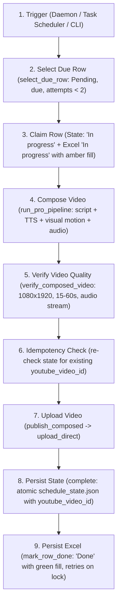

<div align="center">

# 🏛️ Finance Shorts Pro
### Autonomous AI-Powered Finance YouTube Shorts Production Engine

[](https://www.python.org/)
[](https://ffmpeg.org/)
[](https://developers.google.com/youtube/v3)
[](https://ai.google.dev/)
[](https://github.com/rany2/edge-tts)
[](LICENSE)

*An end-to-end, zero-human-intervention production pipeline that autonomously scripts, voices, animates, composes, verifies, and publishes cinematic 1080x1920 YouTube Shorts.*

---

</div>

## 📌 Overview

**Finance Shorts Pro** is an automated production engine designed to educate modern investors on corporate finance, valuation, equity markets, and macroeconomic indicators.

Driven by a structured 14-day, 42-topic curriculum (3 videos daily at 09:00, 15:00, and 20:00 IST from 20-Oct-2026 to 02-Nov-2026), the engine orchestrates AI script generation, neural voice synthesis, dynamic cinematic motion rendering with luxury presenter silhouette plates, safe-zone kinetic subtitles, audio ducking with a subtle *Succession* piano backing track, and direct YouTube Data API v3 upload.

---

## 🏗️ Architecture



---

## 🤖 AI Models, Voice & Video Services

### Script Generation LLMs
- **Google Gemini**: Direct API calls via `GEMINI_API_KEY` utilizing `gemini-flash-lite-latest`, `gemini-flash-latest`, or `gemini-pro-latest`. Generates structured 6-scene storyboards with hook validation and novelty enforcement.
- **OpenRouter**: Optional multi-LLM fallback via `OPENROUTER_API_KEY`.

### Voice Synthesis (TTS)
- **Microsoft Edge-TTS** (`TTS_ENGINE=edge`, default): High-fidelity neural voice synthesis (`en-US-AndrewMultilingualNeural`) with per-word boundary timestamps for kinetic subtitles. No GPU or API keys required.
- **Piper Neural TTS** (`TTS_ENGINE=piper`): Optional local offline neural synthesis engine.

### Visual Compositing & Motion
- **Native Cinematic Composer**: Combines 4K luxury silhouette presenter visual plates, procedural camera pans/zooms, gold typography, and audio ducking (*Succession* BGM).
- **HeyGen** (`HEYGEN_API_KEY`): Optional paid external dependency for AI avatar synthesis. If not configured, the native cinematic composer runs autonomously with zero external cost.

---

## 🚦 Exit Codes

The CLI commands (specifically `python main.py publish-next`) exit with standardized return codes:

| Code | Status | Meaning | Action / Recovery |
|:---:|---|---|---|
| **0** | **OK** | Topic successfully published, nothing currently due, or another run holds the run lock | Normal operation. |
| **1** | **Pipeline Failure** | Error in script generation, TTS, composition, or quality verification | Attempt count incremented. Row retried up to 2 times before marking `Failed`. |
| **2** | **Config / Credentials** | Missing API keys, missing OAuth client secrets, or invalid configuration | Add keys to `.env` or run `python main.py auth-youtube --force`. |
| **3** | **State Conflict** | Excel row marked `Pending` while state records `Done` with a YouTube video ID | Pipeline halts to prevent accidental duplicate uploads. Review Excel vs state. |
| **4** | **Published, Excel Stale** | Video uploaded to YouTube, but Excel file was locked/inaccessible | Video is live and recorded in state. Next run's reconciliation automatically repairs Excel. |

---

## 📁 Repository Structure

```
finance-shorts/
├── assets/
│   ├── fonts/               # Bold typography (Roboto-Black, Montserrat, Outfit)
│   ├── presenter/           # 4K Luxury silhouette character visual plates
│   └── sounds/              # Audio assets (Succession BGM theme)
├── audio/
│   └── tts_engine.py        # Edge-TTS synthesizer with word-level boundary parser
├── automation/
│   ├── run_lock.py          # Inter-process non-blocking file locking (data/.publish.lock)
│   └── schedule_runner.py   # Daily trigger runner, reconciliation, and daemon loop
├── config/                  # Configuration directory (credentials git-ignored)
│   ├── youtube_client_secrets.json  # OAuth2 client secrets from Google Cloud
│   └── youtube_token.json           # Cached OAuth2 refresh token
├── content/
│   ├── openrouter_generator.py # Gemini & LLM script generation engine
│   ├── script_validator.py     # Script duration, vocabulary, and hook uniqueness validator
│   └── topic_reader.py         # Topic metadata parser
├── data/
│   ├── backups/                 # Timestamped backups of publishing_schedule.xlsx
│   ├── publishing_schedule.xlsx # Human-edited 14-Day 3x/day publishing curriculum
│   └── schedule_state.json      # Machine-authoritative state store (atomic writes)
├── legacy/
│   └── daily_worker.py      # [Legacy] Autonomous SQLite + Ollama daily worker
├── production/
│   └── pro_pipeline.py      # End-to-end multi-step orchestration pipeline & validator
├── publishing/
│   └── youtube_publisher.py # Resumable YouTube Data API v3 uploader with test modes
├── storage/
│   ├── schedule_manager.py  # Excel publishing schedule reader/writer & due-row selector
│   └── state_store.py       # Atomic JSON state store with claim/complete lifecycle
├── tools/
│   ├── audit_schedule.py    # Health audit tool for publishing_schedule.xlsx
│   ├── setup_scheduler.ps1  # Windows Task Scheduler registration script
│   └── uninstall_scheduler.ps1 # Task uninstallation script
├── visuals/
│   ├── cinematic_composer.py# Multi-layer FFmpeg compositor (video + audio + subs)
│   ├── graphic_generator.py # Motion graphics and typography overlays
│   └── heygen_generator.py  # Optional HeyGen avatar generator integration
├── config.py                # Centralized configuration loader and validator
├── main.py                  # Primary CLI entry point
├── .env.example             # Environment configuration template
├── .gitignore               # Strict secret & binary filter
└── requirements.txt         # Python dependencies
```

---

## 🚀 Getting Started

### 1. Prerequisites
- **Python**: 3.11 recommended
- **FFmpeg**: Must be installed and accessible in system `PATH`
  ```powershell
  ffmpeg -version
  ```

### 2. Setup Virtual Environment
```bash
python -m venv .venv
# Windows
.venv\Scripts\activate
# Linux / macOS
source .venv/bin/activate

pip install -r requirements.txt
```

### 3. Configure Environment Variables
Copy `.env.example` to `.env`:
```bash
cp .env.example .env
```
Populate `.env` with your settings:
```env
# Gemini API Key (Direct)
GEMINI_API_KEY=your_gemini_api_key_here

# OpenRouter (Optional fallback)
OPENROUTER_API_KEY=your_openrouter_api_key_here

# TTS Configuration ('edge' or 'piper')
TTS_ENGINE=edge
DEFAULT_VOICE=en-US-AndrewMultilingualNeural

# Publishing Mode ('test' or 'production')
PUBLISHING_MODE=production
YOUTUBE_PRIVACY_STATUS=unlisted
YOUTUBE_CATEGORY_ID=27
```

### 4. Authenticate YouTube Channel
Place your `youtube_client_secrets.json` into the `config/` directory, then authenticate:
```bash
python main.py auth-youtube
```
This generates `config/youtube_token.json` with auto-refresh capability.

---

## 💻 CLI Usage

### View Schedule Status
```bash
python main.py schedule-status
```
Displays all 42 topics, current status, and the next due row.

### Publish Next Due Topic
```bash
python main.py publish-next
```
Selects the earliest due row whose scheduled time is past, claims it, renders the video, verifies parameters, uploads to YouTube, and updates state and Excel.

### Local Dry Run
```bash
python main.py publish-next --dry-run
```
Executes the full pipeline up to video verification without uploading to YouTube, without modifying `data/publishing_schedule.xlsx`, and leaves state unchanged.

### Run Scheduled Trigger Daemon
```bash
python main.py run-schedule
```
Runs a persistent background worker triggering at 09:00, 15:00, and 20:00 IST. Fired slots are tracked in `data/schedule_state.json` to prevent duplicate execution across daemon restarts.

### Install Windows Task Scheduler Jobs (Deprecated Local Fallback)
```powershell
python main.py install-scheduler
```
> [!WARNING]
> **Deprecated**: Local Windows Task Scheduler is a fallback mechanism only and requires your PC to remain powered on. Production 24/7 publishing is fully automated via GitHub Actions in the cloud.

---

## ☁️ Cloud Operation (GitHub Actions 24/7)

The production publishing schedule runs 100% autonomously in the cloud via GitHub Actions. Your local PC can be powered off at all times.

### 1. Setup Checklist

Navigate to your GitHub repository: **Settings > Secrets and variables > Actions**.

#### Repository Secrets (`Secrets` tab)
| Secret Name | Required? | Source / Description |
|---|:---:|---|
| `YOUTUBE_CLIENT_SECRETS_JSON` | **Yes** | Content of your Google Cloud OAuth `config/youtube_client_secrets.json` |
| `YOUTUBE_TOKEN_JSON` | **Yes** | Content of authenticated `config/youtube_token.json` |
| `OPENROUTER_API_KEY` | **Yes** | OpenRouter API Key for script generation & LLM failover |
| `GEMINI_API_KEY` | **Yes** | Direct Google Gemini API Key |
| `INSTAGRAM_ACCESS_TOKEN` | Optional | Meta Graph API access token (if Instagram posting is enabled) |
| `INSTAGRAM_ACCOUNT_ID` | Optional | Instagram Professional Account ID |

#### Repository Variables (`Variables` tab)
| Variable Name | Default | Purpose |
|---|:---:|---|
| `PUBLISH_ENABLED` | `false` | **Master Pause Switch**. Must be set to `true` to allow live production publishing. Set to `false` or any other value to pause without failing. |

---

### 2. Generating Credential Secrets

To generate fresh YouTube OAuth credentials:
```powershell
# Authenticate in browser
.venv\Scripts\python main.py auth-youtube --force
```
1. Open `config/youtube_client_secrets.json`, copy the entire JSON text, and paste into repository secret **`YOUTUBE_CLIENT_SECRETS_JSON`**.
2. Open `config/youtube_token.json`, copy the entire JSON text, and paste into repository secret **`YOUTUBE_TOKEN_JSON`**.
3. **Important Security Rule**: Never commit files under `config/` to Git. They are ignored by `.gitignore`.

> [!IMPORTANT]
> **Google OAuth Token Expiration Notice**:
> If your Google Cloud OAuth Consent Screen is in **"Testing"** status, refresh tokens automatically expire after 7 days, causing cloud runs to fail with Exit Code 2. To prevent this, go to Google Cloud Console > **APIs & Services > OAuth consent screen** and set the Publishing Status to **"In production"**. You cannot verify this status programmatically from code.

---

### 3. Go-Live Test Ladder

Follow this sequential verification ladder before enabling automated cron:

1. **Test Run A: Dry-Run Simulation**
   - Trigger manually: **Actions > Publish Finance Shorts > Run workflow** (`mode: test`, `dry_run: true`).
   - *Expected*: Green (Exit Code 0), zero uploads, no state or Excel modifications.
2. **Test Run B: Simulated Video Production**
   - Trigger manually: `mode: test`, `dry_run: false`.
   - *Expected*: Green, generates `TEST-<job_id>` identifier in state.
   - Run `python tools/reset_test_rows.py` to revert test rows back to `Pending`.
3. **Test Run C: Live Unlisted Canary Test**
   - Set repository variable `PUBLISH_ENABLED = true`.
   - Trigger manually: `mode: production`, `dry_run: false`, `force_privacy: unlisted`.
   - *Expected*: Exactly 1 video uploaded to YouTube Studio as Unlisted. Row marked `Done` with live YouTube URL.
4. **Test Run D: Scheduled Cron Verification**
   - Await the next scheduled slot (09:00, 15:00, or 20:00 IST).
   - *Expected*: Workflow fires autonomously, picks the next pending row, uploads, and pushes updated state back to the repo with commit message `chore(schedule): <slot> run exit=0 [skip ci]`.

---

### 4. Operational Controls & Rules

- **Pause Publishing**: Set repo variable `PUBLISH_ENABLED` to `false`. Scheduled runs will exit cleanly with Exit Code 0 and log `"Publishing paused"` (no work done, no alerts opened).
- **Resume Publishing**: Set `PUBLISH_ENABLED` to `true`.
- **Manual Catch-Up**: If a run was missed due to maintenance, trigger **Actions > Publish Finance Shorts > Run workflow** (`mode: production`, `dry_run: false`). The engine automatically selects the earliest overdue pending topic.
- **Git Synchronization Rule**:
  > **Always run `git pull --rebase` before editing `data/publishing_schedule.xlsx` locally, and `git push` immediately after.**
  > If a merge conflict ever occurs, preserve the cloud's `data/schedule_state.json` as authoritative.

---

### 5. 14-Day Publishing Curriculum Timing Table

Generated directly from [data/schedule_state.json](file:///C:/Users/Admin/.gemini/antigravity-ide/scratch/finance-shorts/data/schedule_state.json) via `python tools/print_schedule_table.py`:

| Day # | Date | IST Slot | UTC Cron Time | Row Key | Topic | Status |
|:---:|:---:|:---:|:---|:---:|:---|:---:|
| Day 01 | 20-Oct-2026 | 09:00 IST | 03:30 UTC (`30 3 * * *`) | `D01-09:00` | Yield Curve Inversion and Recession Signals | Done |
| Day 01 | 20-Oct-2026 | 15:00 IST | 09:30 UTC (`30 9 * * *`) | `D01-15:00` | Free Cash Flow vs Net Profit | Done |
| Day 01 | 20-Oct-2026 | 20:00 IST | 14:30 UTC (`30 14 * * *`) | `D01-20:00` | Discounted Cash Flow (DCF) Basics | Done |
| Day 02 | 21-Oct-2026 | 09:00 IST | 03:30 UTC (`30 3 * * *`) | `D02-09:00` | P/E Ratio and Earnings Yield | Done |
| Day 02 | 21-Oct-2026 | 15:00 IST | 09:30 UTC (`30 9 * * *`) | `D02-15:00` | EV/EBITDA vs P/E | Pending |
| Day 02 | 21-Oct-2026 | 20:00 IST | 14:30 UTC (`30 14 * * *`) | `D02-20:00` | Bond Duration and Interest Rate Risk | Pending |
| Day 03 | 22-Oct-2026 | 09:00 IST | 03:30 UTC (`30 3 * * *`) | `D03-09:00` | Operating vs Financial Leverage | Pending |
| Day 03 | 22-Oct-2026 | 15:00 IST | 09:30 UTC (`30 9 * * *`) | `D03-15:00` | Margin Trading and Margin Calls | Pending |
| Day 03 | 22-Oct-2026 | 20:00 IST | 14:30 UTC (`30 14 * * *`) | `D03-20:00` | Call and Put Options Payoff | Pending |
| Day 04 | 23-Oct-2026 | 09:00 IST | 03:30 UTC (`30 3 * * *`) | `D04-09:00` | Implied Volatility and India VIX | Pending |
| Day 04 | 23-Oct-2026 | 15:00 IST | 09:30 UTC (`30 9 * * *`) | `D04-15:00` | Sharpe Ratio: Return per Unit of Risk | Pending |
| Day 04 | 23-Oct-2026 | 20:00 IST | 14:30 UTC (`30 14 * * *`) | `D04-20:00` | Correlation and Real Diversification | Pending |
| Day 05 | 24-Oct-2026 | 09:00 IST | 03:30 UTC (`30 3 * * *`) | `D05-09:00` | Loss Aversion and Investor Behavior | Pending |
| Day 05 | 24-Oct-2026 | 15:00 IST | 09:30 UTC (`30 9 * * *`) | `D05-15:00` | Real Returns After Tax and Inflation | Pending |
| Day 05 | 24-Oct-2026 | 20:00 IST | 14:30 UTC (`30 14 * * *`) | `D05-20:00` | Working Capital Cycle | Pending |
| Day 06 | 25-Oct-2026 | 09:00 IST | 03:30 UTC (`30 3 * * *`) | `D06-09:00` | Return on Equity and DuPont Analysis | Pending |
| Day 06 | 25-Oct-2026 | 15:00 IST | 09:30 UTC (`30 9 * * *`) | `D06-15:00` | Credit Spreads and Corporate Bonds | Pending |
| Day 06 | 25-Oct-2026 | 20:00 IST | 14:30 UTC (`30 14 * * *`) | `D06-20:00` | Put-Call Parity | Pending |
| Day 07 | 26-Oct-2026 | 09:00 IST | 03:30 UTC (`30 3 * * *`) | `D07-09:00` | Options Greeks: Delta and Theta | Pending |
| Day 07 | 26-Oct-2026 | 15:00 IST | 09:30 UTC (`30 9 * * *`) | `D07-15:00` | Short Selling and Borrowing Costs | Pending |
| Day 07 | 26-Oct-2026 | 20:00 IST | 14:30 UTC (`30 14 * * *`) | `D07-20:00` | Dividend Discount Model | Pending |
| Day 08 | 27-Oct-2026 | 09:00 IST | 03:30 UTC (`30 3 * * *`) | `D08-09:00` | Economic Value Added (EVA) | Pending |
| Day 08 | 27-Oct-2026 | 15:00 IST | 09:30 UTC (`30 9 * * *`) | `D08-15:00` | Beta and Systematic Risk | Pending |
| Day 08 | 27-Oct-2026 | 20:00 IST | 14:30 UTC (`30 14 * * *`) | `D08-20:00` | Value at Risk (VaR) and Its Blind Spots | Pending |
| Day 09 | 28-Oct-2026 | 09:00 IST | 03:30 UTC (`30 3 * * *`) | `D09-09:00` | Repo Rate, Reverse Repo and CRR | Pending |
| Day 09 | 28-Oct-2026 | 15:00 IST | 09:30 UTC (`30 9 * * *`) | `D09-15:00` | Real Interest Rates | Pending |
| Day 09 | 28-Oct-2026 | 20:00 IST | 14:30 UTC (`30 14 * * *`) | `D09-20:00` | Quantitative Easing and Balance Sheets | Pending |
| Day 10 | 29-Oct-2026 | 09:00 IST | 03:30 UTC (`30 3 * * *`) | `D10-09:00` | Forward Rates and Currency Hedging | Pending |
| Day 10 | 29-Oct-2026 | 15:00 IST | 09:30 UTC (`30 9 * * *`) | `D10-15:00` | Expense Ratio and Compounding Drag | Pending |
| Day 10 | 29-Oct-2026 | 20:00 IST | 14:30 UTC (`30 14 * * *`) | `D10-20:00` | Bid-Ask Spread and Market Liquidity | Pending |
| Day 11 | 30-Oct-2026 | 09:00 IST | 03:30 UTC (`30 3 * * *`) | `D11-09:00` | Kelly Criterion and Position Sizing | Pending |
| Day 11 | 30-Oct-2026 | 15:00 IST | 09:30 UTC (`30 9 * * *`) | `D11-15:00` | Covered Calls and Premium Income | Pending |
| Day 11 | 30-Oct-2026 | 20:00 IST | 14:30 UTC (`30 14 * * *`) | `D11-20:00` | Active Funds vs Index Funds: Fee Math | Pending |
| Day 12 | 31-Oct-2026 | 09:00 IST | 03:30 UTC (`30 3 * * *`) | `D12-09:00` | Momentum vs Mean Reversion | Pending |
| Day 12 | 31-Oct-2026 | 15:00 IST | 09:30 UTC (`30 9 * * *`) | `D12-15:00` | Earnings Quality and Impairments | Pending |
| Day 12 | 31-Oct-2026 | 20:00 IST | 14:30 UTC (`30 14 * * *`) | `D12-20:00` | Leveraged ETFs and Volatility Decay | Pending |
| Day 13 | 01-Nov-2026 | 09:00 IST | 03:30 UTC (`30 3 * * *`) | `D13-09:00` | Term Premium | Pending |
| Day 13 | 01-Nov-2026 | 15:00 IST | 09:30 UTC (`30 9 * * *`) | `D13-15:00` | Stock Buybacks and EPS Illusion | Pending |
| Day 13 | 01-Nov-2026 | 20:00 IST | 14:30 UTC (`30 14 * * *`) | `D13-20:00` | Debt-to-GDP and Sovereign Debt | Pending |
| Day 14 | 02-Nov-2026 | 09:00 IST | 03:30 UTC (`30 3 * * *`) | `D14-09:00` | Fiscal Deficit vs Current Account Deficit | Pending |
| Day 14 | 02-Nov-2026 | 15:00 IST | 09:30 UTC (`30 9 * * *`) | `D14-15:00` | Monetary Policy Transmission Lags | Pending |
| Day 14 | 02-Nov-2026 | 20:00 IST | 14:30 UTC (`30 14 * * *`) | `D14-20:00` | Survivorship Bias in Fund Performance | Pending |

---

### 6. Cloud Execution Cost & Quotas

- **Runner Execution Time**: ~3.5 minutes per production run on `ubuntu-latest`.
- **14-Day Consumption**: 42 scheduled runs × 3.5 minutes ≈ **147 runner minutes**.
- **GitHub Free-Tier Allowance**: 2,000 runner minutes per month for private repositories (unlimited for public repos).
- **Cost**: **$0.00** (consumes under 7.5% of the free monthly allowance).

---

## 🔧 Troubleshooting

### 1. Excel File Locked (`ExcelLockedError`)
- **Cause**: `data/publishing_schedule.xlsx` is open in Microsoft Excel with exclusive write lock.
- **Resolution**: Close the file in Excel. The pipeline retries saving 5 times with a 3-second wait before raising `ExcelLockedError`. If published before the lock error, exit code 4 is returned and state remains safe.

### 2. State Conflict (Exit Code 3)
- **Cause**: Excel has `Posted? = Pending`, but `data/schedule_state.json` has `Done` with a registered `youtube_video_id`.
- **Resolution**: To prevent accidental double-posting, the pipeline halts immediately. Inspect `data/schedule_state.json` to view the existing upload details. If you wish to re-publish, remove the `youtube_video_id` from state.

### 3. Missing or Expired Token (Exit Code 2)
- **Cause**: `config/youtube_token.json` is missing, corrupted, or has revoked access.
- **Resolution**: Run `python main.py auth-youtube --force` to complete the OAuth2 browser flow.

---

## 🛡️ License

Distributed under the MIT License. See `LICENSE` for details.
