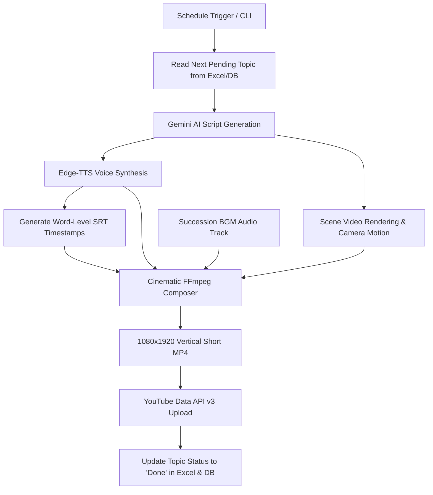

<div align="center">

# 🏛️ Finance Shorts Pro
### Autonomous AI-Powered Finance YouTube Shorts Production Engine

[](https://www.python.org/)
[](https://ffmpeg.org/)
[](https://developers.google.com/youtube/v3)
[](https://ai.google.dev/)
[](https://github.com/rany2/edge-tts)
[](LICENSE)

*An end-to-end, zero-human-intervention production pipeline that autonomously writes, voices, animates, composes, and publishes cinematic 1080x1920 YouTube Shorts directly to your channel.*

---

</div>

## 📌 Overview

**Finance Shorts Pro** is an autonomous production engine designed to educate modern investors on corporate finance, valuation, equity markets, and macroeconomic indicators. 

Driven by a structured 14-day curriculum (3 videos daily at 09:00 AM, 03:00 PM, and 08:00 PM IST), the engine orchestrates AI script generation, neural voice synthesis, dynamic cinematic motion rendering with a consistent luxury presenter silhouette, safe-zone kinetic subtitles, audio ducking with a subtle *Succession* piano backing track, and direct YouTube Data API v3 upload.

---

## ⚡ Key Highlights

- **🧠 Google Gemini & Multi-LLM Script Generation**: Ultra-fast structured script synthesis producing 6-scene storyboards with hook, concept, proof, Indian market context, golden rules, and high-retention CTAs.
- **🎙️ Neural TTS & Kinetic Subtitles**: Microsoft Edge-TTS (*Andrew Multilingual Neural*) generating crisp, authoritative narration paired with per-word timestamped `.srt` kinetic yellow subtitles.
- **🎬 Luxury Character Motion**: Consistent aesthetic featuring a faceless luxury mentor in a tailored suit with gold rim lighting, animated with dynamic camera pans, zoom effects, vignettes, and gold typography.
- **🎼 Succession BGM Integration**: Professional multi-track audio mixing combining vocal tracks with subtle piano BGM ducking and fade-out transitions.
- **📅 14-Day Automated Publishing Schedule**: Synchronized via Excel (`data/publishing_schedule.xlsx`) and SQLite (`data/finance_shorts.db`), with state tracking across all 42 topics.
- **⏰ Unattended OS-Level Scheduling**: Native Windows Task Scheduler integration with wake-to-run and battery-safe flags to execute on schedule without user intervention.
- **🚀 YouTube Data API v3 Upload**: OAuth2 client with auto-refresh token handling, tags, education categorization, description formatting, and `#Shorts` optimization.

---

## 🔄 Production Pipeline Flow



---

## 📁 Repository Structure

```
finance-shorts/
├── assets/
│   ├── fonts/               # Bold typography (Roboto-Black, Montserrat, Outfit)
│   ├── presenter/           # 4K Luxury silhouette character visual plates
│   └── sounds/              # Audio assets (Succession BGM theme)
├── audio/
│   ├── tts_engine.py        # Edge-TTS synthesizer with word-level boundary parser
│   └── srt_generator.py     # SubRip subtitle generator
├── automation/
│   └── schedule_runner.py   # Daily trigger runner & status reporter
├── config/                  # Configuration directory (credentials excluded)
│   └── youtube_token.json   # (Git-ignored OAuth token)
├── content/
│   ├── openrouter_generator.py # Gemini & LLM script generation engine
│   └── prompt_templates.py  # Director-grade prompt templates
├── data/
│   ├── finance_content_queue.xlsx   # Content queue spreadsheet
│   └── publishing_schedule.xlsx     # 14-Day 3x/day publishing curriculum
├── production/
│   └── pro_pipeline.py      # End-to-end multi-step orchestration pipeline
├── publishing/
│   └── youtube_publisher.py # Resumable YouTube Data API v3 uploader
├── storage/
│   ├── database.py          # SQLite persistence layer
│   └── schedule_manager.py  # Excel & SQLite bidirectional synchronization
├── tools/
│   ├── setup_scheduler.ps1  # Windows Task Scheduler registration script
│   └── uninstall_scheduler.ps1 # Task uninstallation script
├── visuals/
│   ├── cinematic_composer.py# Multi-layer FFmpeg compositor (video + audio + subs)
│   ├── graphic_generator.py # Motion graphics and typography overlays
│   └── heygen_generator.py  # Scene generator integration
├── config.py                # Centralized configuration loader
├── main.py                  # Primary CLI entry point
├── .env.example             # Environment configuration template
├── .gitignore               # Strict secret & binary filter
└── requirements.txt         # Python dependencies
```

---

## 🚀 Getting Started

### 1. Prerequisites
- **Python**: 3.10 or 3.11 recommended
- **FFmpeg**: Must be installed and accessible in system `PATH`
  ```powershell
  # Verify FFmpeg
  ffmpeg -version
  ```

### 2. Clone & Setup Virtual Environment
```bash
git clone https://github.com/Abhishek-Aryan/Finance-shorts.git
cd Finance-shorts

python -m venv .venv
# On Windows
.venv\Scripts\activate
# On Linux/macOS
source .venv/bin/activate

pip install -r requirements.txt
```

### 3. Configure Environment Variables
Copy `.env.example` to `.env`:
```bash
cp .env.example .env
```
Fill in your API keys in `.env`:
```env
GEMINI_API_KEY=your_gemini_api_key_here
OPENROUTER_API_KEY=your_openrouter_api_key_here
SCRIPT_MODEL=gemini-flash-lite-latest

# Audio volume mix
BGM_VOLUME=0.18
VOICE_VOLUME=1.25

# Publishing mode: 'test' for simulation, 'production' for live YouTube uploads
PUBLISHING_MODE=production
```

### 4. Authenticate YouTube Channel
Place your `youtube_client_secrets.json` into the `config/` directory, then authenticate:
```bash
python setup_youtube_oauth.py
```
This generates `config/youtube_token.json` with auto-refresh capability.

---

## 💻 CLI Usage

### View Current 14-Day Schedule Status
```bash
python main.py schedule-status
```
Outputs complete Day 1–14 progress, completed topics, and the immediate next topic in queue.

### Produce and Publish Next Topic Immediately
```bash
python main.py publish-next
```
Executes the full pipeline:
1. Generates 6-scene storyboard script with Google Gemini.
2. Synthesizes voiceover with Andrew Neural TTS.
3. Renders visual plates with dynamic camera zoom and gold typography.
4. Blends with *Succession* BGM and kinetic subtitles.
5. Uploads to YouTube Shorts as Public.
6. Marks the topic **✅ Done** in `data/publishing_schedule.xlsx`.

### Test Run Without Publishing (Dry-Run)
```bash
python main.py publish-next --dry-run
```

### Install Windows Task Scheduler Jobs (Automated 9AM, 3PM, 8PM IST)
```bash
python main.py install-scheduler
```

---

## 📊 Published Shorts Example

| Video | Topic | Link |
|---|---|---|
| Day 1 [09:00 AM] | Yield Curve Inversion & Recession | [Watch Short](https://youtube.com/shorts/SUDnd1Dqjfs) |
| Day 1 [03:00 PM] | Free Cash Flow vs Net Profit | [Watch Short](https://youtube.com/shorts/sa5tOX-R44A) |

---

## ⚙️ Configuration Reference

| Variable | Description | Default |
|---|---|---|
| `GEMINI_API_KEY` | Google Gemini API Key | Required |
| `BGM_VOLUME` | Background music volume level | `0.18` (18%) |
| `VOICE_VOLUME` | Narrator voice volume level | `1.25` (125%) |
| `DEFAULT_VOICE` | Edge-TTS Voice identifier | `en-US-AndrewMultilingualNeural` |
| `PUBLISH_TIMES` | Daily trigger times (IST) | `09:00,15:00,20:00` |
| `VIDEO_WIDTH` / `HEIGHT` | Vertical format dimensions | `1080` x `1920` |

---

## 🛡️ License

Distributed under the MIT License. See `LICENSE` for more information.
