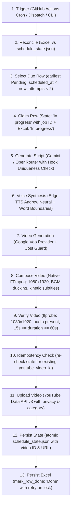

<div align="center">

# 🏛️ Finance Shorts Pro
### Autonomous AI-Powered Finance YouTube Shorts Production Engine

[](https://www.python.org/)
[](https://ffmpeg.org/)
[](https://developers.google.com/youtube/v3)
[](assets/plates/)
[](https://ai.google.dev/)
[](https://github.com/rany2/edge-tts)
[](LICENSE)

*An end-to-end, zero-cost cloud pipeline that autonomously scripts, voices, renders with Ken Burns cinematic luxury plates, composes, verifies, and publishes 1080x1920 YouTube Shorts while your PC is off.*

---

</div>

## 📌 Overview

**Finance Shorts Pro** is an autonomous production engine designed to educate modern investors on corporate finance, valuation, equity markets, and macroeconomic indicators.

Driven by a structured 14-day, 42-topic curriculum (3 videos daily at 09:00, 15:00, and 20:00 IST from 20-Oct-2026 to 02-Nov-2026), the engine operates 24/7 in GitHub Actions without relying on local hardware. The pipeline orchestrates AI script generation, neural voice synthesis, plate-based visual rendering with dynamic Ken Burns motion graphics, safe-zone kinetic subtitles, audio ducking with a subtle *Succession* piano backing track, and direct YouTube Data API v3 upload.

> [!NOTE]
> **Plate-Based Visuals Architecture**: Generative video APIs (Veo/HeyGen) have been replaced with **pre-rendered 9:16 luxury cinematic plates** (`assets/plates/{topic_id}.jpg`). The runtime pipeline composes them using subpixel-supersampled Ken Burns motion, 25% subtitle-zone darkening, and audio ducking, eliminating runtime video API costs ($0 cost in cloud actions) and eliminating video generation timeouts.

---

## 🏗️ Architecture

The production flow executes in strict deterministic order on every run:



---

## 🚦 Exit Codes

The CLI commands (specifically `python main.py publish-next`) exit with standardized return codes:

| Code | Status | Meaning | Action / Recovery |
|:---:|---|---|---|
| **0** | **OK** | Topic successfully published, nothing currently due, or another run holds the run lock | Normal operation. |
| **1** | **Pipeline Failure** | Error in script generation, TTS, composition, or quality verification | Attempt count incremented. Row retried up to 2 times before marking `Failed`. GitHub issue alert created. |
| **2** | **Config / Credentials** | Missing API keys, missing OAuth client secrets, or expired YouTube token | GitHub issue opened. Add secrets or run `python main.py auth-youtube --force`. |
| **3** | **State Conflict** | Excel row marked `Pending` while state records `Done` with a YouTube video ID | Pipeline halts to prevent duplicate uploads. Reconcile Excel vs state. |
| **4** | **Published, Excel Stale** | Video uploaded to YouTube, but Excel file was locked/inaccessible | Video is live and recorded in state. Next run's reconciliation automatically repairs Excel. |
| **5** | **Budget Cap Reached** | Daily or per-run Veo video seconds cap reached (`VEO_MAX_SECONDS_PER_DAY`) | Job halts cleanly before submitting video jobs. Row remains `Pending` for next day. |

---

## 🤖 AI Models, Voice & Video Services

### 1. Script Generation (Google Gemini & OpenRouter)
- **Google Gemini**: Direct API calls via `GEMINI_API_KEY` utilizing official production models (`gemini-flash-lite-latest`, `gemini-flash-latest`, `gemini-pro-latest`, `gemini-2.5-flash`, `gemini-2.0-flash`).
- **Hook Uniqueness Check**: Every generated script's opening hook (first 8 words) is checked against the last 10 published scripts in `schedule_state.json`. If a collision is detected, generation is retried up to 3 times to guarantee fresh intros.
- **OpenRouter**: Configured fallback via `OPENROUTER_API_KEY`.

### 2. Voice Synthesis (TTS) - Multi-Tier High Availability
- **Microsoft Edge-TTS Pool** (`TTS_ENGINE=edge`, default): High-fidelity neural voice synthesis with exact word boundary timestamps for kinetic subtitles.
- **5-Voice Automatic Failover Pool**: If Microsoft drops a connection or a voice server is slow, the engine automatically retries with exponential backoff across 5 curated voices:
  `en-US-AndrewMultilingualNeural` ➔ `en-US-ChristopherNeural` ➔ `en-US-GuyNeural` ➔ `en-US-EricNeural` ➔ `en-IN-PrabhatNeural`.
- **Google TTS (`gTTS`) Secondary Engine**: If all Edge-TTS servers fail, the pipeline instantly engages Google Text-to-Speech with synthetic word-level alignment so audio synthesis never blocks the publishing run.
- **Piper Neural TTS** (`TTS_ENGINE=piper`): Optional local offline neural synthesis engine.

### 3. Plate-Based Visuals & Ken Burns Motion (Zero-Cost Architecture)
- **Pre-Generated Cinematic Plates** (`assets/plates/{topic_id}.jpg`): Each topic in the 42-topic curriculum is paired with a curated, high-resolution 9:16 visual metaphor (minimalist silhouette in luxury setting with cinematic chiaroscuro lighting).
- **Quality Gate Verification** (`visuals/plate_gate.py`): Plates must pass strict programmatic gating (minimum 1080x1920, top/bottom 20% luminance < 90 for clean typography, non-flat standard deviation >= 6.0). Verified plates are tracked in `assets/plates/manifest.json`.
- **Dynamic Ken Burns Motion**: Instead of static backgrounds or paid AI video generators, our compositor animates plates with alternating subpixel-supersampled Ken Burns motion:
  - **Even topics (`T02`, `T04`, ...)**: Slow zoom-in from 1.00x to 1.06x centered at (0.5, 0.42).
  - **Odd topics (`T01`, `T03`, ...)**: Slow zoom-out from 1.06x down to 1.00x centered at (0.5, 0.42).
- **Graceful Fallback**: If a plate is missing or fails the quality gate, the compositor seamlessly falls back to `assets/presenter/mentor_character_1.png` with a logged warning. Cloud publishing runs never fail due to visual assets.

### 4. Audio Ducking & Kinetic Subtitles
- Multi-layer FFmpeg compositor embeds safe-zone word-by-word kinetic subtitles, 25% subtitle-zone darkening at the lower third, and automatically ducks the *Succession* piano backing track (-18dB under speech).
- **Public Visibility by Default**: All videos are uploaded directly with `public` visibility.

---

## 🎨 Plate Generation Workflow

All visual plates are generated pre-commit locally and tracked in git, guaranteeing zero external dependencies or video generation costs in GitHub Actions:

```powershell
# Generate plates for specific topics or all missing curriculum topics
python tools/generate_plates.py --all

# Or generate for a specific topic ID
python tools/generate_plates.py --topic T14

# Re-evaluate all plates against the quality gate
python tools/generate_plates.py --re-gate
```

- **Cloud Actions**: In GitHub Actions, the runner simply loads the committed `.jpg` plate from `assets/plates/`. No video generation APIs or external image credentials are used at runtime.
- **Budget Cap Exit Code (5)**: Exit code 5 remains supported for backward compatibility, but runtime video generation is now 100% free ($0).

---

## ☁️ Cloud Operation (GitHub Actions 24/7)

The production publishing schedule runs 100% autonomously in GitHub Actions (`.github/workflows/publish_shorts.yml`). Your local PC can remain powered off.

### 1. Setup Secrets and Variables

In GitHub: go to **Settings > Secrets and variables > Actions**.

#### Repository Secrets (`Secrets` tab)
| Secret Name | Required? | Source / Description |
|---|:---:|---|
| `YOUTUBE_CLIENT_SECRETS_JSON` | **Yes** | Entire content of `config/youtube_client_secrets.json` from Google Cloud Console |
| `YOUTUBE_TOKEN_JSON` | **Yes** | Entire content of authenticated `config/youtube_token.json` |
| `GEMINI_API_KEY` | **Yes** | Google Gemini API Key (used for Veo video generation and script writing) |
| `OPENROUTER_API_KEY` | Optional | OpenRouter API Key (fallback for script generation) |
| `INSTAGRAM_ACCESS_TOKEN` | Optional | Meta Graph API access token (if Instagram posting is enabled) |
| `INSTAGRAM_ACCOUNT_ID` | Optional | Instagram Professional Account ID |

#### Repository Variables (`Variables` tab)
| Variable Name | Default | Purpose |
|---|:---:|---|
| `PUBLISH_ENABLED` | `false` | **Master Safety Switch**. Must be set to `'true'` to allow live production publishing. Set to `'false'` to pause. |

---

### 2. Generating & Refreshing YouTube Credentials

```powershell
# Authenticate in browser locally once
python main.py auth-youtube --force
```

1. Copy content of `config/youtube_client_secrets.json` into GitHub secret `YOUTUBE_CLIENT_SECRETS_JSON`.
2. Copy content of `config/youtube_token.json` into GitHub secret `YOUTUBE_TOKEN_JSON`.

> [!IMPORTANT]
> **Google OAuth Token Expiration Notice**:
> If your Google Cloud OAuth Consent Screen is in **"Testing"** status, refresh tokens expire every 7 days, causing cloud runs to fail with Exit Code 2. To avoid interruptions:
> 1. Open Google Cloud Console > **APIs & Services > OAuth consent screen**.
> 2. Click **"Publish App"** to change status to **"In production"**.
> 3. Re-run `python main.py auth-youtube --force` and update `YOUTUBE_TOKEN_JSON`.

---

### 3. Schedule Triggers & Times

Runs 3 times daily at:
- **09:00 IST** (03:30 UTC): cron `'30 3 * * *'`
- **15:00 IST** (09:30 UTC): cron `'30 9 * * *'`
- **20:00 IST** (14:30 UTC): cron `'30 14 * * *'`

### 4. Pausing & Resuming the Cloud Schedule

- **To Pause**: Navigate to **Settings > Secrets and variables > Actions > Variables**, edit `PUBLISH_ENABLED`, and set to `false`. Workflow runs will exit cleanly with Exit Code 0 and log `"Publishing paused: set repository variable PUBLISH_ENABLED to true to resume"`.
- **To Resume**: Set `PUBLISH_ENABLED` back to `true`.

### 5. Autonomous Self-Healing Watchdog (`watchdog.yml`)

- Runs every hour at minute 25 (`25 * * * *`, off-peak).
- Inspects `data/schedule_state.json` for any curriculum topic overdue by >1.5 hours in `Pending` state.
- **Automated Recovery**: If GitHub Actions ever drops or delays a scheduled cron run, the watchdog automatically files an issue alert and immediately dispatches `publish_shorts.yml` to publish the overdue slot without any human intervention.

---

## 🔄 Local Manual Fallback Workflow

If you ever need to manually publish a topic locally from your PC, execute these steps in this **exact order**:

```bash
# 1. Fetch latest state from cloud
git pull origin main

# 2. IMPORTANT: Pause cloud runs so local and cloud do not overlap!
# Set GitHub repository variable PUBLISH_ENABLED = false via GitHub web UI or gh CLI:
# gh variable set PUBLISH_ENABLED --body "false"

# 3. Publish the next due topic locally
python main.py publish-next

# 4. Stage ONLY the state and schedule data files (never commit config/ or output/)
git add data/publishing_schedule.xlsx data/schedule_state.json data/usage_ledger.json

# 5. Commit state changes
git commit -m "chore(schedule): manual publish fallback [skip ci]"

# 6. Rebase to catch any concurrent changes
git pull --rebase origin main

# 7. Push to remote
git push origin main

# 8. Re-enable cloud runs when ready:
# gh variable set PUBLISH_ENABLED --body "true"
```

> [!CAUTION]
> **No Overlapping Runs**: Local and cloud runs must never run concurrently. Always pause `PUBLISH_ENABLED` before running manual local production.

---

## 💻 CLI Commands Reference

All commands remain available:

```bash
# Production & Schedule
python main.py publish-next              # Publish next pending topic (exit codes 0-5)
python main.py publish-next --dry-run    # Dry-run validation without uploading
python main.py schedule-status           # Display 14-day schedule overview
python main.py run-schedule [--dry-run]  # Run foreground schedule daemon
python main.py auth-youtube [--force]    # Authorize YouTube OAuth channel

# Legacy Commands
python main.py init                      # [Legacy] Initialise SQLite database and Excel queue
python main.py status                    # [Legacy] SQLite pipeline status summary
python main.py sync                      # [Legacy] Sync SQLite to Excel
python main.py topics [--status <S>]     # [Legacy] List SQLite topics
python main.py generate [--topic-id <ID>]# [Legacy] Generate script via local LLM
python main.py produce [--topic-id <ID>] # [Legacy] Render video via local pipeline
python main.py publish [--topic-id <ID>] # [Legacy] Publish video to YouTube & Instagram
python main.py run-daily [--max-videos 1]# [Legacy] Autonomous SQLite + Ollama daily cycle

# Deprecated Local Scheduler Commands
python main.py install-scheduler         # [Deprecated] Register Windows Task Scheduler jobs
python main.py uninstall-scheduler       # [Deprecated] Remove Windows Task Scheduler jobs
```

### Removing Deprecated Local Windows Tasks
If Windows Task Scheduler tasks were previously installed on your machine, remove them with:
```powershell
python main.py uninstall-scheduler
# Or directly via PowerShell:
Unregister-ScheduledTask -TaskName "FinanceShorts_0900" -Confirm:$false -ErrorAction SilentlyContinue
Unregister-ScheduledTask -TaskName "FinanceShorts_1500" -Confirm:$false -ErrorAction SilentlyContinue
Unregister-ScheduledTask -TaskName "FinanceShorts_2000" -Confirm:$false -ErrorAction SilentlyContinue
```

---

## 🔧 Troubleshooting

### 1. Excel File Locked (`ExcelLockedError`)
- **Cause**: `data/publishing_schedule.xlsx` is open in Microsoft Excel with exclusive write lock.
- **Resolution**: Close Excel. The publisher automatically retries saving 5 times at 3-second intervals before raising `ExcelLockedError`. If video was already uploaded, state persists the video ID and returns Exit Code 4.

### 2. State Conflict (Exit Code 3)
- **Cause**: Excel has `Posted? = Pending`, but `data/schedule_state.json` already has `Done` with a registered `youtube_video_id`.
- **Resolution**: Pipeline halts to prevent accidental double-posting. Inspect `data/schedule_state.json`. If re-upload is explicitly desired, delete the `youtube_video_id` entry from `schedule_state.json`.

### 3. Expired or Revoked Token (Exit Code 2)
- **Cause**: `config/youtube_token.json` has expired or the OAuth app is in "Testing" mode (which expires tokens after 7 days).
- **Resolution**: Ensure OAuth consent screen is "In production", then run:
  ```powershell
  python main.py auth-youtube --force
  ```
  Copy the updated content of `config/youtube_token.json` to the `YOUTUBE_TOKEN_JSON` secret in GitHub.

### 4. Budget Cap Reached (Exit Code 5)
- **Cause**: Generated video seconds have reached `VEO_MAX_SECONDS_PER_DAY` (default 60s).
- **Resolution**: The row remains `Pending` and is safely picked up on the next day. To increase the daily allowance, set `VEO_MAX_SECONDS_PER_DAY=180` in your environment or workflow configuration.

---

## 🛡️ License

Distributed under the MIT License. See `LICENSE` for details.
