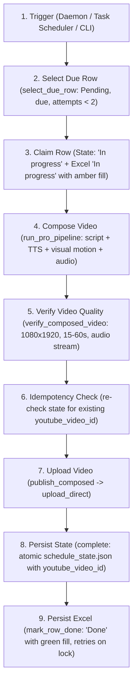

<div align="center">

# 🏛️ Finance Shorts Pro
### Autonomous AI-Powered Finance YouTube Shorts Production Engine

[](https://www.python.org/)
[](https://ffmpeg.org/)
[](https://developers.google.com/youtube/v3)
[](https://ai.google.dev/)
[](https://github.com/rany2/edge-tts)
[](LICENSE)

*An end-to-end, zero-human-intervention production pipeline that autonomously scripts, voices, animates, composes, verifies, and publishes cinematic 1080x1920 YouTube Shorts.*

---

</div>

## 📌 Overview

**Finance Shorts Pro** is an automated production engine designed to educate modern investors on corporate finance, valuation, equity markets, and macroeconomic indicators.

Driven by a structured 14-day, 42-topic curriculum (3 videos daily at 09:00, 15:00, and 20:00 IST from 20-Oct-2026 to 02-Nov-2026), the engine orchestrates AI script generation, neural voice synthesis, dynamic cinematic motion rendering with luxury presenter silhouette plates, safe-zone kinetic subtitles, audio ducking with a subtle *Succession* piano backing track, and direct YouTube Data API v3 upload.

---

## 🏗️ Architecture



---

## 🤖 AI Models, Voice & Video Services

### Script Generation LLMs
- **Google Gemini**: Direct API calls via `GEMINI_API_KEY` utilizing `gemini-flash-lite-latest`, `gemini-flash-latest`, or `gemini-pro-latest`. Generates structured 6-scene storyboards with hook validation and novelty enforcement.
- **OpenRouter**: Optional multi-LLM fallback via `OPENROUTER_API_KEY`.

### Voice Synthesis (TTS)
- **Microsoft Edge-TTS** (`TTS_ENGINE=edge`, default): High-fidelity neural voice synthesis (`en-US-AndrewMultilingualNeural`) with per-word boundary timestamps for kinetic subtitles. No GPU or API keys required.
- **Piper Neural TTS** (`TTS_ENGINE=piper`): Optional local offline neural synthesis engine.

### Visual Compositing & Motion
- **Native Cinematic Composer**: Combines 4K luxury silhouette presenter visual plates, procedural camera pans/zooms, gold typography, and audio ducking (*Succession* BGM).
- **HeyGen** (`HEYGEN_API_KEY`): Optional paid external dependency for AI avatar synthesis. If not configured, the native cinematic composer runs autonomously with zero external cost.

---

## 🚦 Exit Codes

The CLI commands (specifically `python main.py publish-next`) exit with standardized return codes:

| Code | Status | Meaning | Action / Recovery |
|:---:|---|---|---|
| **0** | **OK** | Topic successfully published, nothing currently due, or another run holds the run lock | Normal operation. |
| **1** | **Pipeline Failure** | Error in script generation, TTS, composition, or quality verification | Attempt count incremented. Row retried up to 2 times before marking `Failed`. |
| **2** | **Config / Credentials** | Missing API keys, missing OAuth client secrets, or invalid configuration | Add keys to `.env` or run `python main.py auth-youtube --force`. |
| **3** | **State Conflict** | Excel row marked `Pending` while state records `Done` with a YouTube video ID | Pipeline halts to prevent accidental duplicate uploads. Review Excel vs state. |
| **4** | **Published, Excel Stale** | Video uploaded to YouTube, but Excel file was locked/inaccessible | Video is live and recorded in state. Next run's reconciliation automatically repairs Excel. |

---

## 📁 Repository Structure

```
finance-shorts/
├── assets/
│   ├── fonts/               # Bold typography (Roboto-Black, Montserrat, Outfit)
│   ├── presenter/           # 4K Luxury silhouette character visual plates
│   └── sounds/              # Audio assets (Succession BGM theme)
├── audio/
│   └── tts_engine.py        # Edge-TTS synthesizer with word-level boundary parser
├── automation/
│   ├── run_lock.py          # Inter-process non-blocking file locking (data/.publish.lock)
│   └── schedule_runner.py   # Daily trigger runner, reconciliation, and daemon loop
├── config/                  # Configuration directory (credentials git-ignored)
│   ├── youtube_client_secrets.json  # OAuth2 client secrets from Google Cloud
│   └── youtube_token.json           # Cached OAuth2 refresh token
├── content/
│   ├── openrouter_generator.py # Gemini & LLM script generation engine
│   ├── script_validator.py     # Script duration, vocabulary, and hook uniqueness validator
│   └── topic_reader.py         # Topic metadata parser
├── data/
│   ├── backups/                 # Timestamped backups of publishing_schedule.xlsx
│   ├── publishing_schedule.xlsx # Human-edited 14-Day 3x/day publishing curriculum
│   └── schedule_state.json      # Machine-authoritative state store (atomic writes)
├── legacy/
│   └── daily_worker.py      # [Legacy] Autonomous SQLite + Ollama daily worker
├── production/
│   └── pro_pipeline.py      # End-to-end multi-step orchestration pipeline & validator
├── publishing/
│   └── youtube_publisher.py # Resumable YouTube Data API v3 uploader with test modes
├── storage/
│   ├── schedule_manager.py  # Excel publishing schedule reader/writer & due-row selector
│   └── state_store.py       # Atomic JSON state store with claim/complete lifecycle
├── tools/
│   ├── audit_schedule.py    # Health audit tool for publishing_schedule.xlsx
│   ├── setup_scheduler.ps1  # Windows Task Scheduler registration script
│   └── uninstall_scheduler.ps1 # Task uninstallation script
├── visuals/
│   ├── cinematic_composer.py# Multi-layer FFmpeg compositor (video + audio + subs)
│   ├── graphic_generator.py # Motion graphics and typography overlays
│   └── heygen_generator.py  # Optional HeyGen avatar generator integration
├── config.py                # Centralized configuration loader and validator
├── main.py                  # Primary CLI entry point
├── .env.example             # Environment configuration template
├── .gitignore               # Strict secret & binary filter
└── requirements.txt         # Python dependencies
```

---

## 🚀 Getting Started

### 1. Prerequisites
- **Python**: 3.11 recommended
- **FFmpeg**: Must be installed and accessible in system `PATH`
  ```powershell
  ffmpeg -version
  ```

### 2. Setup Virtual Environment
```bash
python -m venv .venv
# Windows
.venv\Scripts\activate
# Linux / macOS
source .venv/bin/activate

pip install -r requirements.txt
```

### 3. Configure Environment Variables
Copy `.env.example` to `.env`:
```bash
cp .env.example .env
```
Populate `.env` with your settings:
```env
# Gemini API Key (Direct)
GEMINI_API_KEY=your_gemini_api_key_here

# OpenRouter (Optional fallback)
OPENROUTER_API_KEY=your_openrouter_api_key_here

# TTS Configuration ('edge' or 'piper')
TTS_ENGINE=edge
DEFAULT_VOICE=en-US-AndrewMultilingualNeural

# Publishing Mode ('test' or 'production')
PUBLISHING_MODE=production
YOUTUBE_PRIVACY_STATUS=unlisted
YOUTUBE_CATEGORY_ID=27
```

### 4. Authenticate YouTube Channel
Place your `youtube_client_secrets.json` into the `config/` directory, then authenticate:
```bash
python main.py auth-youtube
```
This generates `config/youtube_token.json` with auto-refresh capability.

---

## 💻 CLI Usage

### View Schedule Status
```bash
python main.py schedule-status
```
Displays all 42 topics, current status, and the next due row.

### Publish Next Due Topic
```bash
python main.py publish-next
```
Selects the earliest due row whose scheduled time is past, claims it, renders the video, verifies parameters, uploads to YouTube, and updates state and Excel.

### Local Dry Run
```bash
python main.py publish-next --dry-run
```
Executes the full pipeline up to video verification without uploading to YouTube, without modifying `data/publishing_schedule.xlsx`, and leaves state unchanged.

### Run Scheduled Trigger Daemon
```bash
python main.py run-schedule
```
Runs a persistent background worker triggering at 09:00, 15:00, and 20:00 IST. Fired slots are tracked in `data/schedule_state.json` to prevent duplicate execution across daemon restarts.

### Install Windows Task Scheduler Jobs
```powershell
python main.py install-scheduler
```
Registers native Windows scheduled tasks calling `run.bat` at 09:00, 15:00, and 20:00 IST.

---

## 🔧 Troubleshooting

### 1. Excel File Locked (`ExcelLockedError`)
- **Cause**: `data/publishing_schedule.xlsx` is open in Microsoft Excel with exclusive write lock.
- **Resolution**: Close the file in Excel. The pipeline retries saving 5 times with a 3-second wait before raising `ExcelLockedError`. If published before the lock error, exit code 4 is returned and state remains safe.

### 2. State Conflict (Exit Code 3)
- **Cause**: Excel has `Posted? = Pending`, but `data/schedule_state.json` has `Done` with a registered `youtube_video_id`.
- **Resolution**: To prevent accidental double-posting, the pipeline halts immediately. Inspect `data/schedule_state.json` to view the existing upload details. If you wish to re-publish, remove the `youtube_video_id` from state.

### 3. Missing or Expired Token (Exit Code 2)
- **Cause**: `config/youtube_token.json` is missing, corrupted, or has revoked access.
- **Resolution**: Run `python main.py auth-youtube --force` to complete the OAuth2 browser flow.

---

## 🛡️ License

Distributed under the MIT License. See `LICENSE` for details.
